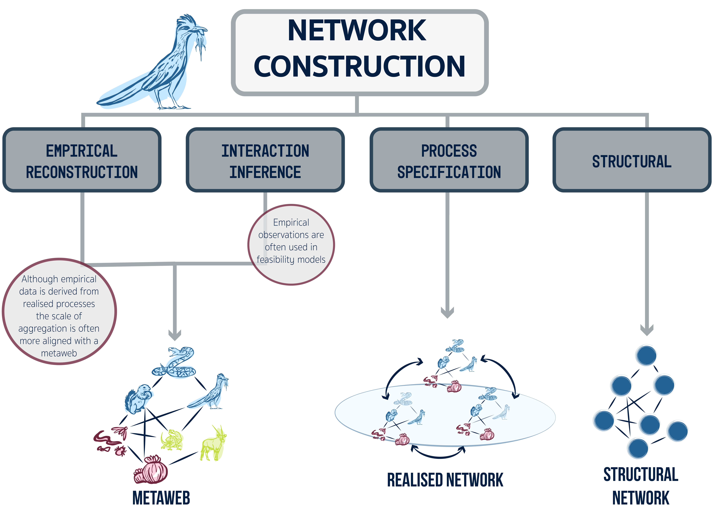

# Introduction

At the heart of biodiversity science are theories linking species richness, stability, and ecosystem functioning, from the foundational work of @eltonAnimalEcology2001, @lindemanTrophicDynamicAspectEcology1942, and @macarthurFluctuationsAnimalPopulations1955 to contemporary questions about biodiversity loss and ecosystem resilience. Trophic networks (food webs) are central to these questions because they capture the feeding interactions underpinning energy flow, community structure, and ecosystem functioning [@cohenCommunityFoodWebs1990; @martinezTimeSpaceScale1998; @dunneNetworkStructureBiodiversity2002a; @simmonsRefocusingMultipleStressor2021]. Documenting these interactions provides a foundation for mathematical and statistical models used to understand biodiversity and anticipate the consequences of environmental change [@windsorUsingEcologicalNetworks2023; @galianaBioticInteractionsBiogeography2026].

Yet food webs do more than describe feeding interactions -- their construction embeds assumptions about the ecological processes that generate and constrain those interactions. These assumptions have been discussed in relation to sampling effort, aggregation, and scale [@cohenCommunityFoodWebs1990; @polisComplexTrophicInteractions1991; @martinezArtifactsAttributesEffects1991; @bluthgenWhyNetworkAnalysis2010; @dormannRisePossibleFall2023], as well as network interpretation and application [@bluthgenCriticalEvaluationNetwork2024; @brimacombeApplyingMethodIts2024]. Challenges in collecting and observing interactions are also well documented [@bluthgenCriticalEvaluationNetwork2024; @brimacombeShortcomingsReusingSpecies2023; @brimacombePublicationdrivenConsistencyFood2024; @moulatletScalingTrophicSpecialization2024; @pringleResolvingFoodWebStructure2020; @polisComplexTrophicInteractions1991; @saberskiImpactDataResolution2024; @martinezTimeSpaceScale1998; @pimmComplexityStabilityEcosystems1984a]. However, these discussions have yet to provide a clear process-based account of how the data and assumptions used to construct a food web shape its representation, what ecological processes it captures, and which questions it can answer. Recent work by @gauzensTailoringInteractionNetwork2025 synthesised trophic network representations by node resolution and link type. We address a complementary question: how do ecological processes generate different representations, and what can each representation legitimately tell us?

We propose a process-based hierarchy linking global metawebs (representing evolutionarily feasible feeding interactions), to regional metawebs (constrained by spatiotemporal overlap), and then to realised food webs (shaped by local ecological processes). The central contribution is to connect these representations through the processes that constrain or realise their links, clarifying how their assumptions differ, and where their ecological inferences may diverge. This framework provides a basis for choosing network representations to match ecological questions and for assessing when incorporating process information improves ecological prediction.

We focus on trophic networks, which provide a well-developed foundation for distinguishing evolutionarily feasible interactions from those realised through spatiotemporal overlap, abundance, and consumer diet choice. Although communities are also structured by mutualistic, competitive, parasitic, and facilitative interactions, we do not develop a general framework for all ecological interaction networks. Extending the hierarchy to these interactions will require additional assumptions about how they become feasible and realised. The framework also generates testable predictions about the transitions between network representations (Box 1). We outline hypotheses that can be evaluated using comparative, experimental, and time-resolved interaction data, but treat these as ways to assess the framework rather than as its primary contribution. We examine how nodes and edges define alternative representations (@sec-anatomy), then consider the processes (@sec-process) and construction approaches (@sec-construct) that generate them, before discussing how the framework can guide network choice and ecological inference (@sec-progress).

# Setting the Scene: The Not So Basics of Nodes and Edges {#sec-anatomy}

Ecological networks represent an ‘object’ from which inferences can be made and thus serve multiple purposes. While many aspects of community structure can be analysed without networks (*e.g.,* trait distributions or abundance patterns) networks provide a formal framework for capturing the organisation of interactions among species. Networks are used to study emergent properties of the community such as energy flow[@odumEnergyFlowEcosystems1968; @lindemanTrophicDynamicAspectEcology1942], complexity [@montoyaEcologicalNetworksTheir2006], and stability [@pimmComplexityStabilityEcosystems1984a; @schneiderAnimalDiversityEcosystem2016]. They allow researchers to examine how interactions among species influence community responses to change [@haoGlobalProjectionTerrestrial2025], understand how they shape communities [@pecuchetNovelFeedingInteractions2020], and determine its robustness [@dunneNetworkStructureBiodiversity2002a; @staniczenkoStructuralDynamicsRobustness2010].

But a network is not a neutral description of a community. Its structure depends on what is represented as a node, what counts as an edge, and the spatial, temporal, and biological scales at which these are defined. These choices affect which features of a community the network captures and what can be inferred from it [@poisotDescribeUnderstandPredict2016; @moulatletScalingTrophicSpecialization2024]. To understand what different food webs can tell us, we therefore begin with how their nodes and edges are defined.

## How do we define a node?

Although nodes are conventionally described as representing species, they can correspond to a range of taxonomic and non-taxonomic units, including trophic species (*e.g.,* [@yodzisCompartmentationRealAssembled1982; @williamsSimpleRulesYield2000]), feeding guilds (*e.g.,* @garcia-callejasNonrandomInteractionsGuilds2023), or species-specific life stages (*e.g.,* @cleggImpactIntraspecificVariation2018). These choices reflect differences in the level and consistency of resolution at which networks are constructed, rather than aggregation *per se*. Coarser or mixed-resolution nodes can limit taxon-specific inference (*e.g.,* whether species *a* consumes species *b*), bias estimates of degree distributions, particularly generality and vulnerability, and complicate analyses of extinction or invasion dynamics by obscuring species identities and the consequences of their loss [@beckermanForagingBiologyPredicts2006; @cleggImpactIntraspecificVariation2018]. Yet aggregation can also be appropriate when interactions among functional or trophic units are more informative than species-level detail, for example when analysing extinction patterns across feeding guilds [@dunhillExtinctionCascadesCommunity2024]. Resolution, scale, and sampling have long been recognised as central to food web construction and interpretation (*e.g.,* [@martinezTimeSpaceScale1998; @dunneNetworkStructureFood2006]). Node definition is therefore not merely a methodological choice: it determines which ecological entities a network represents, which processes can be captured, and which questions can be addressed [@gauzensTailoringInteractionNetwork2025].

## What is captured by an edge? {#sec-edge}

Understanding how edge assumptions shape ecological process representation requires distinguishing between potential and realised links. Potential links represent feasible interactions between species [@dunneNetworkStructureFood2006; @pringleUntanglingFoodWebs2020], whereas realised links represent interactions expressed within a system, including the transfer of energy or materials through feeding [@lindemanTrophicDynamicAspectEcology1942; @proulxNetworkThinkingEcology2005]. Edges can therefore represent different ecological 'currencies' [@gauzensTailoringInteractionNetwork2025]. They can also differ in how interactions are quantified: links may be binary (present or absent), probabilistic [@banvilleDecipheringProbabilisticSpecies2025; @poisotStructureProbabilisticNetworks2016], or represented by continuous measures of interaction strength [@berlowInteractionStrengthsFood2004]. Edge definition thus depends on both the ecological currency being represented and how interactions are quantified. These choices determine the processes a network can capture and the inferences it can support. For example, a network of feasible interactions can characterise potential trophic structure but cannot, on its own, establish the magnitude or distribution of energy flow, because its links are not constrained by the environmental conditions or energetic processes governing realised interactions.

## Network representations {#sec-representation}

Node and edge definitions, together with the assumptions they encode, give rise to two well-established types of ecological network: **metawebs**, which represent potential interactions within a species pool [@dunneNetworkStructureFood2006], and **realised networks**, which represent interactions expressed within a particular community, place, and time. These representations differ not only in spatial and temporal scope but also in the processes assumed to generate their structure.

A metaweb is fundamentally a list of feasible interactions between species. It identifies evolutionarily and regionally plausible links, excludes ecologically impossible (*i.e.,* forbidden) interactions [@jordanoSamplingNetworksEcological2016], and characterises the potential diet breadth of species [@strydomGraphEmbeddingTransfer2023]. Feasibility is determined primarily by trait complementarity, particularly traits associated with feeding, and can be further constrained by species co-occurrence. This produces a transition from global to regional metawebs as the set of potentially interacting species is restricted.

Realised networks, by contrast, are localised in space and time, with links shaped by co-occurrence, environmental conditions, and consumer diet choice. Even when represented as binary matrices, their links reflect interactions that have passed through these ecological filters and may therefore imply energy transfer. Realised networks are not simply spatial or temporal subsets of metawebs; they emerge from the processes governing whether, and to what extent, interactions occur within a particular community. Consequently, a metaweb and a realised network containing the same species may differ substantially in structure because their links are subject to different constraints. Critically, a link absent from a metaweb represents an interaction deemed infeasible under the assumptions used to construct it, whereas a link absent from a realised network may reflect context-dependent ecological constraints, limited observation, or both. At its most general, a realised network must therefore represent more than the potential for species interactions: it must capture their occurrence or strength within a particular community.

# From Nodes and Edges to Process and Constraints {#sec-process}

The definitions of nodes and edges establish what a food web represents; the distinction between metawebs and realised networks clarifies which processes and inferences each representation supports. We frame these representations as stages in a hierarchy governed by five trophic processes: evolutionary compatibility, spatiotemporal overlap, abundance, consumer diet choice, and non-trophic interaction modification [@fig-process]. Each transition imposes a distinct ecological filter, making differences between representations testable in terms of process rather than data format alone. The framework is not exhaustive; it isolates these five processes so their assumptions and contributions can be evaluated separately.

![Conceptual summary of the process-based hierarchy linking food-web representations to ecological filters. A **global metaweb** represents evolutionarily feasible consumer–resource links across a defined species pool. Restricting this pool by spatiotemporal overlap yields **regional metawebs**, which differ with regional species composition. Species occurring in both regions are shown in red, whereas region-specific species are shown in blue and yellow. **Realised food webs** emerge when abundance, consumer diet choice, and non-trophic interaction modification further filter feasible links under local conditions. The arrows represent transitions that can be tested separately: compatibility constrains the global feasible set; overlap constrains the regional set; and ecological context determines which remaining links occur and how strongly. The framework predicts nested constraints in principle, while allowing empirical estimates to differ because of uncertainty, incomplete sampling, and scale mismatch.](images/anatomy.png){#fig-process}

## Processes that determine the feasibility of an interaction {#sec-process-feasibility}

Two constraints define trophic interaction feasibility: evolutionary compatibility and spatiotemporal overlap. The first reflects trait complementarity; the second limits potential interactions to species able to encounter one another. Together, they define the feasible consumer–resource pairs and underpin the transition from global to regional metawebs.

**Evolutionary compatibility**

Interaction feasibility is first constrained by functional compatibility between consumers and resources. Traits associated with resource acquisition and defence determine whether a feeding interaction is physically and biologically possible, defining the feasible interaction space represented by a metaweb. Evolutionary history and co-evolution shape these traits, making phylogenetic relationships and trait complementarity useful predictors of interaction feasibility, rather than direct evidence that an interaction is realised.

This constraint reflects the evolutionary history of consumers and resources [@segarRoleEvolutionShaping2020; @gomezEcologicalInteractionsAre2010; @dallarivaExploringEvolutionarySignature2016; @rossbergFoodWebsExperts2006], expressed through trait complementarity between species [@benadiQuantitativePredictionInteractions2022]. Consumers must possess traits that permit them to acquire and consume particular resources, while resource traits may enable or prevent consumption. Interactions lacking this compatibility are defined as forbidden links [@jordanoSamplingNetworksEcological2016]: feeding interactions that are physically or biologically impossible and therefore excluded from the feasible interaction space.

Evolutionary compatibility defines feasible consumer–resource pairs, represented as binary (possible versus forbidden) or probabilistic interactions [@banvilleDecipheringProbabilisticSpecies2025]. In the metaweb of @strydomFoodWebReconstruction2022, for example, probabilities express confidence that a feeding interaction is possible. Such networks align with global metawebs because they can include feasible links between species that do not currently overlap in space or time [@fig-process].

**Spatiotemporal overlap (encounter opportunity)**

Even when consumers and resources are evolutionarily compatible, a feeding interaction can only occur if they overlap in space and time. We therefore distinguish spatiotemporal overlap, which provides the opportunity for species to encounter one another, from observed co-occurrence, a statistical pattern that can arise for reasons unrelated to direct interactions [@blanchetCooccurrenceNotEvidence2020].

Spatiotemporal overlap restricts the feasible interactions in a global metaweb to those that could occur within a particular region or community, providing the transition from global to regional metawebs [@dansereauSpatiallyExplicitPredictions2024]. In @fig-process, this transition is illustrated by the metawebs for regions one and two, which differ in species composition and therefore in the set of feasible interactions. However, overlap is necessary but not sufficient for a trophic interaction: species that occupy the same region need not encounter one another at the relevant spatial and temporal scales, much less interact.

A regional metaweb represents feasible interactions among regionally occurring species, not necessarily those realised in a community. The ability of two species to interact does not establish that they will [@poisotSpeciesWhyEcological2015; @caronTraitmatchingModelsPredict2024].

This distinction matters because empirical food webs are sometimes inferred from species occurrence or co-occurrence data. Treating co-occurrence as evidence of realised feeding blurs the distinction between regional metawebs and realised food webs, potentially giving similar network structures very different ecological interpretations.

## Processes that realise networks {#sec-process-realisation}

Within the feasible interaction space defined by evolutionary compatibility and spatiotemporal overlap, three processes—abundance, consumer diet choice, and non-trophic interaction modification—shape which links occur and how strongly, affecting energy transfer within communities [@fig-process]. They filter, strengthen, weaken, or prevent feasible links under particular ecological conditions rather than creating them independently of compatibility.

**Abundance**

Abundance provides a baseline expectation for realisation: under a null model, consumers feed randomly among feasible resources in proportion to prey abundance [@stephensForagingTheory1986; @vazquezUnitingPatternProcess2009]. Within a regional metaweb, abundance influences encounter frequency and the probability of feeding [@poisotSpeciesWhyEcological2015; @banvilleDecipheringProbabilisticSpecies2025]. It can therefore help predict the distribution and strength of realised links, but does not establish feasibility or capture selective behaviour and other constraints on feeding.

**Diet choice**

Consumers do not necessarily feed in proportion to resource abundance; they can select resources according to their energetic returns and the costs of acquiring and consuming them [@stephensForagingTheory1986]. Consumer diet choice reflects energetic cost–benefit trade-offs centred on prey profitability and constrained by traits associated with resource acquisition and consumption [@woottonModularTheoryTrophic2023; @smithBehavioralResponsesMosaic2021]. These energetic constraints underpin a range of approaches to constructing realised food webs [@beckermanForagingBiologyPredicts2006; @pawarDimensionalityConsumerSearch2012; @portalierMechanicsPredatorPrey2019; @cherifEnvironmentRescueCan2024].

Unlike approaches that specify feasible interactions alone, these models generate realised food webs as outcomes of consumer behaviour. This differs from models such as the Niche Model [@williamsSimpleRulesYield2000], in which diet choice is implicit in a probabilistic network-generating function designed to reproduce expected network structure, rather than emerging from explicit ecological rules governing individual consumers. Here, we use diet choice as an umbrella term for processes derived from optimal foraging theory [@pykeOptimalForagingTheory1984] and metabolic theory [@brownMetabolicTheoryEcology2004] that determine the distribution and strength of realised trophic interactions.

**Non-trophic interactions**

Non-trophic interactions are included here not as trophic links in their own right, but as processes that modify the occurrence or strength of trophic interactions within realised food webs [@mieleNontrophicInteractionsStrengthen2019; @ingsEcologicalNetworksbeyondFood2009]. They extend the ecological context beyond evolutionary compatibility, spatiotemporal overlap, and abundance by altering encounter rates, feeding success, mortality, or access to resources [@golubskiModifyingModifiersWhat2011; @pilosofMultilayerNatureEcological2017].

Such effects can arise through direct interactions among consumers, including predator interference or competition for space, or through indirect interactions, such as refuge provisioning, habitat modification, and facilitation, that alter the probability or strength of feeding interactions [@ingsEcologicalNetworksbeyondFood2009; @golubskiModifyingModifiersWhat2011; @staniczenkoStructuralDynamicsRobustness2010; @kamaruDisruptionAntplantMutualism2024].

Some systems illustrate why trophic and non-trophic processes are not always cleanly separable. Pollinators, for example, consume floral resources through trophic interactions while also influencing plant reproduction, recruitment, and population persistence through non-trophic processes [@hollandPopulationDynamicsMutualism2002; @bascomptePlantAnimalMutualisticNetworks2007; @sauveHowPlantsConnect2016]. We use such systems to illustrate how non-trophic processes modify trophic network realisation, rather than extending the framework to mutualistic networks in general [@kefiMoreMealIntegrating2012; @kefiNetworkStructureFood2015; @bucheMultitrophicHigherOrderInteractions2024; @mieleNontrophicInteractionsStrengthen2019].

::: {#hypoth-box .callout-note title="Testable hypotheses"}

Although recent work from @strydomAreWeMapping2026 has shown that different network representations do indeed result in different inferences about changes in communities and networks across time it remains to be seen if these differences can be ascribed to specific processes. The framework we present here generates predictions that distinguish it from a purely descriptive classification of network types. The hypotheses below are intended to be testable rather than exhaustive. Existing studies motivate the mechanisms, but do not necessarily test each hypothesis in the integrated form stated here; evidence should therefore be treated as suggestive where direct tests are lacking.

**Hypothesis 1 — Feasibility constraint.** After accounting for uncertainty in interaction records, a model that represents evolutionary and trait compatibility will exclude more biologically impossible links than a model based only on species occurrence, and its predicted feasible links will transfer better to independent species combinations. This hypothesis can be tested by comparing trait- or phylogeny-informed metaweb predictions with independent feeding records, including both confirmed interactions and credible forbidden links. Work linking evolutionary history and trait complementarity to interactions provides a mechanistic basis for the prediction [@segarRoleEvolutionShaping2020; @gomezEcologicalInteractionsAre2010; @dallarivaExploringEvolutionarySignature2016; @benadiQuantitativePredictionInteractions2022]. However, prediction remains sensitive to the traits measured, and apparent forbidden links may reflect insufficient observation rather than true incompatibility. The hypothesis would be weakened if compatibility-informed models did not improve discrimination of feasible and forbidden links in independent data.

**Hypothesis 2 — Regional filtering.** For a fixed global metaweb, restricting links to species with spatiotemporal overlap will reduce the predicted interaction set, but overlap alone will overpredict realised feeding relative to observations from the same region and time window. This can be tested by comparing global metawebs, regional metawebs, and independently observed local food webs while matching spatial grain, temporal window, and sampling effort. The distinction between co-occurrence and interaction is supported by arguments that co-occurrence is not direct evidence of biotic interaction [@blanchetCooccurrenceNotEvidence2020], while regional network approaches demonstrate the utility of incorporating distributions and biotic associations [@albouyProjectedSpeciesDistribution2014; @pellissierComparingSpeciesInteraction2018]. A result in which overlap alone consistently predicts local feeding as well as models incorporating additional ecological filters would challenge the claim that regional filtering is insufficient.

**Hypothesis 3 — Context-dependent realisation.** Within the set of feasible regional links, models incorporating consumer and resource abundance will outperform uniform or random allocation as a baseline for predicting interaction frequency, but their gains will be largest where diet choice and non-trophic effects are weak. This can be tested using repeated interaction observations alongside abundance data, then evaluating predictions on held-out sites or time periods. Abundance-based null expectations and the importance of consumer choice provide the mechanistic rationale [@stephensForagingTheory1986; @vazquezUnitingPatternProcess2009]. Yet consumers can select prey non-randomly, and non-trophic processes can modify encounter rates or feeding success [@woottonModularTheoryTrophic2023; @mieleNontrophicInteractionsStrengthen2019]. Accordingly, abundance-only models may perform poorly in systems with strong preference, interference, or facilitation; this is a predicted boundary condition, not evidence that abundance is irrelevant.

**Hypothesis 4 — Process-informed prediction.** When evaluated on independent data, models that represent the relevant transition processes will predict context-specific links and network properties more accurately than structure-based models calibrated only to reproduce aggregate topology, especially under environmental change or species turnover. A fair test should compare models using the same training data and evaluate both link-level and network-level outcomes. This prediction follows from the distinction between reproducing structure and identifying the processes that generate it, a distinction also reflected in work on network reconstruction and validation [@strydomRoadmapPredictingSpecies2021; @poisotGuidelinesPredictionSpecies2023; @allesinaGeneralModelFood2008]. Structure-based models may nevertheless remain competitive for questions restricted to aggregate topology, and process-rich models may fail when their mechanisms are poorly measured or misspecified. The hypothesis would therefore be supported only if improvements generalise to held-out conditions and are not limited to the response variable used for calibration.

Across all four hypotheses, evaluation should distinguish uncertainty in biological feasibility from uncertainty caused by missing observations. Non-detection is not equivalent to a forbidden interaction, and predictive performance should be reported for links and for the structural or ecological quantities relevant to the stated question. Where possible, tests should use independent sites, time periods, or taxa to avoid evaluating a framework against the same evidence used to construct it.

:::

# Network construction {#sec-construct}

The processes described above determine the assumptions embedded in different approaches to network construction. Each approach imposes distinct constraints on what a network represents and which inferences it supports. Here, we classify construction approaches according to the information used to assign interactions and the ecological meaning of the resulting links. We distinguish four broad approaches: empirical, which records observed interactions; feasibility-based, which infers potential interactions; process-based, which models how feasible interactions become realised; and structure-based, which generates networks according to structural rules. These approaches differ in the assumptions they make about how interactions arise and therefore the ecological questions they can address.

## Why infer food webs?

Food webs represent biodiversity, but they are also models of ecological systems. Ideally, every trophic interaction could be observed directly. In practice, interaction data are costly to collect, incomplete, and often impossible to obtain across entire communities [@jordanoChasingEcologicalInteractions2016; @jordanoSamplingNetworksEcological2016; @poisotGlobalKnowledgeGaps2021]. Food webs must therefore be constructed from empirical observations, ecological inference, or models of network structure, each of which embeds different assumptions about how interactions arise.

The choice of construction approach depends on what an edge is intended to represent. Is the objective to document an interaction that occurred, infer whether an interaction is feasible, predict which interactions will be realised under specified ecological conditions, or generate a network with particular structural properties? These objectives distinguish four broad approaches (@fig-build). An empirical edge records evidence of feeding under sampled conditions; a feasibility-based edge represents an interaction that could occur under appropriate conditions, as in a metaweb; a process-based edge represents an interaction predicted to be realised under specified ecological conditions; and a structure-based edge is generated according to probabilistic rules governing network structure, without necessarily representing a species-specific ecological interaction.

{#fig-build}

These approaches are not mutually exclusive in their implementation. Process-based models may use feasibility networks as their starting point, feasibility models may be parameterised using empirical interaction data, and random network generators may be fitted to structural properties observed in empirical food webs. The distinction instead concerns the basis on which links are assigned and the ecological interpretation given to the resulting network.

This distinction matters because food web topology underpins analyses of community structure, energy flux, extinction cascades, ecosystem functioning, and dynamical stability [@danetResponseDiversityMajor2024]. Differences in topology can reflect genuine ecological variation among communities, but can also arise from differences in sampling strategy, taxonomic resolution, and construction methodology [@brimacombeShortcomingsReusingSpecies2023; @brimacombePublicationdrivenConsistencyFood2024]. Understanding how a network was constructed is therefore essential for interpreting what it represents and which ecological questions it can legitimately address. Network construction should be treated as an explicit modelling decision: it determines what information an edge encodes, which ecological processes are represented, and what inferences can be drawn.

## Reconstruction from empirical evidence {#sec-construct-empirical}

Empirical food webs are constructed from observations or measurements of realised trophic interactions. However, different methods capture different aspects of feeding and vary in their temporal and taxonomic resolution, uncertainty, and the ecological meaning of the resulting links.

Direct observations record feeding events in the field or laboratory and provide direct evidence that an interaction occurred under sampled conditions [@jordanoSamplingNetworksEcological2016]. Such observations are typically incomplete, however, because interactions are difficult to monitor continuously across entire communities. Consequently, an unobserved interaction should not necessarily be interpreted as one that cannot occur.

Gut and stomach content analyses identify recently consumed prey, while scat analysis and DNA metabarcoding extend this approach by detecting prey DNA in faecal samples. These methods provide empirical evidence of feeding but capture snapshots of recent diet and are subject to biases associated with digestion, detection, and sampling effort [@pompanonWhoEatingWhat2012; @sousaDNAMetabarcodingDiet2019]. The resulting network represents interactions detectable by the method over its relevant temporal window, rather than necessarily capturing each consumer's complete diet.

Stable isotope analyses provide evidence of assimilated energy pathways and trophic position over longer temporal windows, offering indirect evidence of trophic relationships rather than direct observations of feeding events [@postUsingStableIsotopes2002]. Similarly, molecular approaches, including environmental DNA and interaction metabarcoding, can reveal trophic relationships that are otherwise difficult to observe, although the certainty with which they establish specific feeding interactions varies.

The ecological scope of an empirical network also depends on the spatial and temporal extent of sampling. When observations are aggregated across locations or sampling periods, the resulting network may represent interactions occurring across a broader set of conditions than those realised simultaneously within a single community. Such networks may therefore function more appropriately as metawebs [@brimacombeApplyingMethodIts2024]. However, empirical metawebs should not be assumed to be complete [@polisComplexTrophicInteractions1991], and inferred interactions may be needed to supplement observations (see @sec-construct-feasibility).

The meaning of an empirical edge ultimately depends on the evidence used to define it. A binary link establishes that feeding was detected under sampled conditions, but does not necessarily quantify interaction frequency, strength, contribution to consumer energy budgets, or importance for community dynamics. Inferring energy transfer therefore requires information beyond the presence or absence of an observed interaction.

## Inference of Interactions {#sec-construct-feasibility}

Feasibility-based approaches infer trophic interactions from the properties of consumers and resources, drawing on the evolutionary compatibility processes described in @sec-process-feasibility. Rather than establishing whether feeding was observed or predicting whether it will occur under specific ecological conditions, these approaches use ecological rules, species traits, and phylogenetic relationships to identify potentially feasible interactions [@morales-castillaInferringBioticInteractions2015; @dallarivaExploringEvolutionarySignature2016; @bramonmoraIdentifyingCommonBackbone2018].

Species-specific approaches infer potential interactions between particular consumer–resource pairs and are therefore conceptually aligned with metawebs. They typically rely on three assumptions: that ecological rules constrain interaction feasibility [@morales-castillaInferringBioticInteractions2015]; that some of these rules are conserved across species or phylogenetic lineages [@dallarivaExploringEvolutionarySignature2016; @bramonmoraIdentifyingCommonBackbone2018]; and that the properties of consumers and resources can be used to infer their compatibility.

Evolutionary compatibility and co-occurrence constraints are central to constructing first-draft networks for communities for which interaction data are unavailable [@strydomFoodWebReconstruction2022]. They also support the reconstruction of networks in data-poor regions and the prediction of interactions in unobservable communities, including prehistoric food webs [@yeakelCollapseEcologicalNetwork2014; @frickeCollapseTerrestrialMammal2022; @dunhillExtinctionCascadesCommunity2024], and in novel future assemblages [@vanderputtenPredictingSpeciesDistribution2010]. These approaches can also help evaluate how species interactions shape distributions by accounting for both environmental conditions and biotic relationships [@higinoMismatchIUCNRange2023; @pollockUnderstandingCooccurrenceModelling2014; @gravelBringingEltonGrinnell2019; @albouyProjectedSpeciesDistribution2014].

Feeding rules can be specified in several ways. Expert-based approaches identify feasible interactions using trait matching [@shawFrameworkReconstructingAncient2024; @roopnarineEcologicalModellingPaleocommunity2017; @albouyMarineFishFood2019], while mechanistic approaches use trait-based relationships between consumers and resources [@gravelInferringFoodWeb2013; @rohrModelingFoodWebs2010]. Statistical and machine-learning methods instead estimate interaction probabilities from observed networks and ecological predictors, including traits and phylogeny [@pichlerMachineLearningAlgorithms2020].

Related approaches use observed interaction data to train classifiers based on ecological proxies that are more widely available, such as species traits. These include generalised linear models [@caronAddressingEltonianShortfall2022], random forests [@llewelynPredictingPredatorPrey2023], trait-based (k)-nearest-neighbour methods [@desjardins-proulxEcologicalInteractionsNetflix2017], and Bayesian models [@eklofSecondaryExtinctionsFood2013; @cirtwillQuantitativeFrameworkInvestigating2019]. Depending on their formulation and training data, these methods may estimate interaction feasibility or the probability of observing an interaction under the conditions represented in the data. These interpretations should not be treated as equivalent.

Graph-embedding approaches provide another route to inferring missing or unknown interactions. They use the structure of a known network to infer the positions of species in a latent representation, combining network information with ecological proxies such as phylogenetic relatedness [@strydomFoodWebReconstruction2022]. The resulting representation can then be used to predict interactions in an incompletely observed network [@strydomGraphEmbeddingTransfer2023].

A related set of approaches aims to interpolate missing interactions within observed networks [@bitonInductiveLinkPrediction2025; @stockLinearFilteringReveals2017; @dallasPredictingCrypticLinks2017; @poisotNetworkEmbeddingUnveils2023; @habedankNewPerspectiveRevealing2025; @beauchesneThinkingOutsideBox2016]. These methods infer links from existing interactions and network structure, sometimes incorporating additional ecological information. An inferred link, however, is not equivalent to an observed interaction: it represents a prediction supported by the information and assumptions used in the inference procedure.

The ecological interpretation of feasibility-based networks therefore depends on the rules and evidence used to assign links. Such networks can characterise potential trophic structure and provide a starting point for predicting realised interactions, but feasibility alone does not establish that feeding occurs within a particular community.

## Specification based on process {#sec-construct-process}

Process-based approaches predict realised food webs by modelling the ecological processes that determine whether feasible trophic interactions occur within communities. Rather than inferring feasibility alone, they operationalise the abundance, diet-choice, and non-trophic processes introduced in @sec-process-realisation to predict which interactions are realised and, in some cases, the resulting distribution of energy transfer. These networks are used to investigate energy flux, extinction dynamics, ecosystem functioning, and relationships between network structure, stability, productivity, and ecosystem function. They also provide the structural basis for dynamical models examining secondary extinctions, species invasions, and climate change.

Because these approaches represent species properties and feeding processes explicitly, network structure emerges from modelled consumer–resource dynamics rather than from feasibility rules or structural constraints alone. The same species assemblage can therefore yield different networks under different conditions. This detail comes at a cost: models often require extensive community and environmental data, depend on their behavioural assumptions, and do not necessarily represent all feasible interactions beyond the conditions modelled.

### Abundance-based models

Abundance-based models provide a simple way to represent the transition from feasible to realised interactions. Neutral models assume that consumers feed randomly among feasible resources, with interaction probabilities related to prey abundance [@canardEmpiricalEvaluationNeutral2014; @krishnaNeutralnicheTheoryNestedness2008]. Under this formulation, feasibility defines the pool of potential interactions, while abundance influences which interactions are likely to occur.

These models illustrate how two communities can share the same feasible interaction space yet produce different realised networks because their species abundances differ. They are not necessarily intended as complete explanations of trophic interactions; rather, they provide a baseline process through which feasible links are filtered into community-specific predictions. They can therefore be combined with feasibility-based approaches to generate localised food webs [@pomeranzInferringPredatorPrey2019].

### Energetic and behavioural models

A broader class of process-based approaches predicts realised interactions through energetic and behavioural constraints on feeding. These models often use consumer–resource body-size relationships as proxies for the energetic costs and benefits of prey capture, handling, and consumption. Rather than identifying feasibility alone, they use energetic constraints to determine which feasible interactions are likely to be realised.

For example, models developed by @portalierMechanicsPredatorPrey2019 and @woottonModularTheoryTrophic2023 incorporate energetic constraints on predator–prey relationships. Their resulting links represent predicted feeding interactions under the assumptions and conditions of the model, rather than simply identifying biologically compatible species pairs.

Diet-choice models provide a related approach by representing how consumers allocate feeding effort among available resources. Models such as @beckermanForagingBiologyPredicts2006 and @petcheySizeForagingFood2008 determine interactions through assumptions about consumer foraging behaviour. Because diet choice affects both which interactions occur and how feeding is distributed across resources, these models can generate realised links and emergent network structure. Their process-based interpretation can be strengthened by explicitly incorporating trait-based constraints on feasible interactions [@curtsdotterEcosystemFunctionPredator2019] or complemented by more explicit representations of nutrient dynamics [@cuffNetworkingNutrientsHow2024].

These models allow the same species assemblage to generate different realised networks as abundance, environmental conditions, energetic constraints, or behavioural rules change.

## Structure-based construction {#sec-construct-random}

Structure-based approaches generate edges according to probabilistic rules governing network structure, rather than evidence for or predictions about particular species interactions. An edge in such a network does not necessarily indicate that two species are ecologically compatible or that feeding is expected to occur. Instead, it represents a relationship generated under a model of network structure.

Random and structural models are commonly used to establish null expectations, provide comparative baselines, and generate synthetic networks for dynamical modelling. Because they require little or no species-specific interaction information, they can generate networks even when empirical information about the focal community is limited. Their primary purpose is generally not to reconstruct the trophic relationships of a particular community, but to test whether observed or predicted patterns differ from those expected under specified structural rules.

Alongside random graph models such as the Erdős–Rényi model [@erdosRandomGraphs1959], approaches have been developed that take existing networks and randomise their interactions to generate alternative configurations while preserving selected structural properties [@fortunaHabitatLossStructure2006; @bascompteNestedAssemblyPlantanimal2003a; @banvilleWhatConstrainsFood2023]. Although such models do not directly reconstruct the ecological processes governing real-world interactions [@bascompteNetworksEcology2007], they provide useful null hypotheses for evaluating the significance of observed network structure.

Stochastic food web models commonly impose probabilistic rules governing properties such as connectance, diet breadth, trophic position, or the distribution of interactions along a niche axis. The Niche Model, for example, generates trophic interactions according to species' positions along a one-dimensional niche axis [@williamsSimpleRulesYield2000]. The Cascade Model similarly generates networks using rules concerning trophic ordering [@cohenCommunityFoodWebs1990], while the Nested Hierarchy Model incorporates assumptions about nested structure and phylogenetic constraints [@cattinPhylogeneticConstraintsAdaptation2004]. These models can reproduce important statistical properties of empirical food webs [@stoufferQuantitativePatternsStructure2005] without explicitly representing the identity-specific mechanisms responsible for particular feeding interactions.

The resulting networks are best regarded as structural or synthetic representations. Their edges are generated under a network-level model rather than established through observations or predictions of realised feeding. This makes them valuable for distinguishing structural expectations from empirical patterns [@strydomSVDEntropyReveals2021] and for providing inputs to dynamical models, including allometric trophic networks [@broseAllometricScalingEnhances2006; @schneiderAnimalDiversityEcosystem2016] and bioenergetic food web models [@delmasSimulationsBiomassDynamics2017].

However, the ability of a structural model to reproduce properties of empirical food webs does not establish that it has recovered the ecological mechanisms generating those interactions. It demonstrates instead that the specified structural rules are sufficient to reproduce the properties being evaluated. The interpretation of such networks therefore depends on whether the objective is to establish a structural null expectation, generate a synthetic network for simulation, or investigate the mechanisms underlying particular trophic relationships.

## Construction choices shape ecological inference

Food web construction determines not only network structure but also the ecological meaning of its interactions and the scope of inference it supports. Empirical links provide evidence of feeding under sampled conditions; feasibility-based links represent biologically plausible interactions; process-based links predict interactions under specified ecological conditions; and structure-based models generate networks against which observed or predicted patterns can be compared without necessarily identifying the interactions occurring in a particular community.

These distinctions are especially important when networks are used to investigate ecological responses to environmental change. A network representing potential interactions within a regional species pool can inform questions about alternative feeding relationships, community assembly, and the potential for interaction rewiring. However, it cannot, without additional assumptions, establish which interactions will be realised at a particular place and time. Conversely, an observed network provides evidence of interactions detected under specific sampling conditions but may not capture the full set of feasible interactions or the distribution of feeding across different environmental contexts.

Network construction should therefore be treated as an explicit modelling decision [@strydomAreWeMapping2026]. Its inferential value depends on the alignment between the assumptions used to construct the network and the ecological quantity of interest. These assumptions should be made explicit when networks are constructed, compared, or used to predict ecological change [@brimacombePublicationdrivenConsistencyFood2024]. In particular, three questions should guide their interpretation: What quantity or process is being inferred? What evidence and assumptions support that inference? And what independent evidence can be used to evaluate the resulting network or its predictions?

# Making Progress with Networks {#sec-progress}

Ecological networks are increasingly used in conservation, environmental risk assessment, and natural resource management to understand how stressors and disturbances propagate through communities, moving beyond species-specific responses to ecosystem-level consequences [@loreauBiodiversityEcosystemStability2013a]. By representing direct and indirect feeding relationships, networks provide a framework for investigating stability, resilience, biodiversity, and ecosystem functioning, including how environmental gradients and anthropogenic pressures affect communities beyond their immediate effects on individual species.

This potential is particularly relevant to unresolved questions about stability–diversity–productivity relationships, the drivers and consequences of extinctions and invasions, and the impacts of multiple stressors across ecological scales [@simmonsRefocusingMultipleStressor2021]. However, the inferences that networks support depend on what their links represent, how they were constructed, and the spatial and temporal scales at which they apply [@gauzensTailoringInteractionNetwork2025]. A network of feasible interactions across a species pool does not describe the same ecological system as a network of interactions expressed within a particular community. Likewise, reproducing the structural properties of an empirical food web does not, by itself, identify the mechanisms generating those properties or predict responses to environmental change.

We therefore argue that network applications should begin with three explicit decisions: what do we want to infer, which network representation can support that inference, and how will the inference be evaluated? These decisions connect the ecological processes discussed in @sec-process-feasibility with the construction approaches described in @sec-construct. Table @tbl-questions maps common research questions to global metawebs, regional metawebs, and realised networks, highlighting both their inferential potential and the limitations that arise when their meanings are conflated.

| Network Representation | Common Inferential Pitfall | Principal questions and applications | Representative Studies |
|-------------|-------------|----------------------|----------------------------|
| Global Metaweb | Treating feasible links as evidence of realised feeding or energy flow. | How will novel communities respond to *e.g.,* extinction, turnover, invasion and rewilding $^\checkmark$ | @gravelMeaningFunctionalTrait2016; @dunneNetworkStructureBiodiversity2002a |
|  |  | Diet-based conservation focusing not only on the target species but the species it might depend on for food resources $^\Delta$ | @rooneyIntegratingFoodWeb2012; @curtsdotterRobustnessSecondaryExtinctions2011; @mcdonald-maddenUsingFoodwebTheory2016 |
|  |  | Rewiring capacity/potential of species by looking at the *entire* diets of species $^\Delta$ | @gilljamAdaptiveRewiringAggravates2015; @staniczenkoStructuralDynamicsRobustness2010; @suAdaptiveRewiringShapes2024; @marjakangasFundamentalInteractionNiches2025 |
|  |  | Eco-Evolutionary dynamics and how they relate to the conservation and origination of feeding strategies $^\times$ | @poisotSpeciesWhyEcological2015; @baskervilleSpatialGuildsSerengeti2011 |
| Regional Metawebs | Assuming co-occurrence implies trophic interaction | Applied use potential of questions highlighted for global metawebs at the management scale *e.g.,* a protected area $^\Delta$ | @albouyProjectedSpeciesDistribution2014; @pellissierComparingSpeciesInteraction2018; @estradaUsingNetworkCentrality2008 |
|  |  | Refinement/extension of species distribution models by incorporating co-occurrence and species associations *e.g.,* predator and prey $^\checkmark$ | @araujoImportanceBioticInteractions2007; @kisslingNovelApproachesModelling2012 |
| Realised Webs | Assuming observed binary links quantify interaction strength or complete diets. | The allocation of multiple stressors across networks $^\Delta$ | @crainInteractiveCumulativeEffects2008; @beauchesneSensitivityFoodWebs2021 |
|  |  | Temperature threshold to community collapse $^\Delta$ | @ogormanSimpleModelPredicts2019; @petcheyPredictingEffectsTemperature2010 |
|  |  | Extinction and persistence after harvesting/invasion/extinction $^\checkmark$ | @allesinaStabilityCriteriaComplex2012; @yodzisMustTopPredators2001 |
|  |  | Stability-diversity-productivity-function $^\checkmark$ | @thebaultStabilityEcologicalCommunities2010; @rooneyIntegratingFoodWeb2012 |
|  |  | Explicilty tying ecosystem level processes and nutrient flows to networks $^\times$ | @mooreDetritusTrophicDynamics2004 |
|  |  | Meta communities and the idea of meta-network-communities $^\Delta$ | @gravelStabilityComplexityModel2016; @gilarranzEffectsNetworkModularity2017 |

: Mapping research questions to network representations and highlighting studies that address these questions or identify emerging research directions. This mapping is indicative rather than exhaustive; the appropriate representation depends on the specific inference and the evidence available. {#tbl-questions}

## Matching network representations to ecological questions

The choice of network representation should follow the ecological unit of interest, rather than simply the availability of a dataset or analytical method. The distinctions provided in Box 1 serve as a practical guidance for selecting, constructing, and evaluating networks. Below we discuss this in more detail for each type of network reconstruction.

::: {#ecoeov-box .callout-note title="Question mapping"}

**Global metawebs**

*Primary question*: Which feeding interactions are biologically feasible within a broader species pool?

*Use when:* Investigating potential diet breadth, evolutionary constraints on feeding, novel communities, species introductions, or the potential for interaction rewiring under future environmental conditions.

*You need:* A defined species pool and evidence or assumptions about interaction compatibility, typically based on traits, phylogeny, or documented interactions. Spatial co-occurrence need not be imposed if the aim is to represent the broader feasible interaction space.

*It lets you infer:* Which interactions are plausible, which appear incompatible, and which potential feeding relationships could become relevant as species distributions or environmental conditions change.

*Check it by:* Testing predictions against independent interaction records where possible, including evidence for both feasible and forbidden links. Assess sensitivity to the species pool, trait definitions, and rules used to infer compatibility.

*Do not infer:* That every feasible interaction occurs, that all listed interactions can occur simultaneously, or that the network describes energy flow in any particular community.

**Regional metawebs**

*Primary question:* Which feasible interactions are possible among species that occur, or are expected to occur, within a region?

*Use when:* Examining potential interactions within a regional species pool, anticipating community changes following range shifts, or assessing possible feeding relationships involving introduced or reintroduced species.

*You need:* A regional species pool, distribution or co-occurrence information at an appropriate scale, and rules for identifying feasible feeding relationships.

*It lets you infer:* How regional species availability constrains the feasible interaction space, and how that space may change as species distributions shift.

*Check it by:* Comparing predicted species occurrence and feasible interactions with independent distribution and interaction data. When comparing regions, separate changes due to species turnover from changes in interaction constraints.

*Do not infer:* That co-occurring species necessarily interact, or that differences between regional networks necessarily reflect changes in feeding behaviour or interaction processes.

**Realised networks**

*Primary question:* Which interactions occur, and how are they distributed or expressed, under particular ecological conditions?

*Use when:* Investigating community responses to environmental change, temporal rewiring, trophic dynamics, or the consequences of altered interactions for ecosystem functioning.

*You need:* Interaction observations or a predictive model that represents relevant ecological conditions, such as species abundance, environmental context, and diet choice. The temporal window and sampling process should be explicit.

*It lets you infer:* Which interactions are supported under the sampled or modelled conditions, and (where the data permit) how interaction frequencies or strengths change through space or time.

*Check it by:* Evaluating predictions against independent observations, accounting for imperfect detection and sampling effort, and assessing whether the network captures the properties relevant to the ecological question.

*Do not infer:* That unobserved links are impossible, or that a network aggregated across many places or times represents a single community state.

:::

### Global Metawebs {#sec-progress_metaweb}

Global metawebs are most appropriate for questions about interaction feasibility and potential diet breadth [@mestreMetawebsToolConnect2026; @adhuryaMetawebApproachesUnderstanding2025]. They provide a framework for exploring hypothetical or novel communities under climate change [@huiHowInvadeEcological2019], species invasions, reintroductions, and rewilding, including the potential for species to rewire their interactions [@marjakangasFundamentalInteractionNiches2025]. Because global metawebs represent a broad pool of feasible links, they can also support investigations of eco-evolutionary dynamics and how evolutionary history, natural selection, and phenotypic plasticity shape interaction niches.

However, a global metaweb describes potential interactions, not the ecological conditions under which they occur. Its usefulness therefore depends on how well the inferred feasible interaction space represents biological compatibility and on how that space is translated into a specific community or ecological scenario. In conservation applications, for example, a species' potential diet can help identify the resources it may depend on, but cannot establish which resources sustain it in a particular location [@rooneyIntegratingFoodWeb2012; @curtsdotterRobustnessSecondaryExtinctions2011; @mcdonald-maddenUsingFoodwebTheory2016]. Similarly, the presence of a potential link may indicate an opportunity for rewiring, but does not demonstrate that a consumer will adopt that interaction [@gilljamAdaptiveRewiringAggravates2015; @staniczenkoStructuralDynamicsRobustness2010; @suAdaptiveRewiringShapes2024].

### Regional Metawebs {#sec-progress_regional}

Regional metawebs constrain the potential interaction space to species occurring, or expected to occur, within a defined region. This makes them particularly relevant to management questions involving protected areas, changing species distributions, and anticipated shifts in community composition. They can also help refine species distribution models by incorporating information about biotic associations [@albouyProjectedSpeciesDistribution2014; @pellissierComparingSpeciesInteraction2018; @estradaUsingNetworkCentrality2008; @araujoImportanceBioticInteractions2007; @kisslingNovelApproachesModelling2012].

The key challenge is distinguishing constraints imposed by regional species availability from constraints on feeding compatibility. Co-occurrence can restrict which interactions are possible, but is not sufficient evidence that trophic interactions occur. Likewise, differences in regional metawebs across space or environmental gradients may arise from species turnover (e.g., (\beta)-diversity), differences in inferred interaction feasibility, or both. Comparisons should therefore separate changes in the species pool from changes in the rules or evidence used to infer interactions.

### Realised networks

Realised networks are best suited to questions about which interactions occur under particular ecological conditions and how their expression shapes community dynamics and ecosystem functioning [@thuillerNavigatingIntegrationBiotic2024]. They provide the appropriate starting point for investigating the propagation of multiple stressors [@crainInteractiveCumulativeEffects2008; @beauchesneSensitivityFoodWebs2021], temperature-related thresholds in community collapse [@ogormanSimpleModelPredicts2019; @petcheyPredictingEffectsTemperature2010], persistence following harvesting or species loss [@allesinaStabilityCriteriaComplex2012; @yodzisMustTopPredators2001], and relationships between stability, diversity, productivity, and ecosystem function [@thebaultStabilityEcologicalCommunities2010; @rooneyIntegratingFoodWeb2012]. They can also support investigations of metacommunity dynamics when interactions are considered across multiple local communities [@gravelStabilityComplexityModel2016; @gilarranzEffectsNetworkModularity2017].

These inferences depend on how closely the network corresponds to the community state and process of interest. A binary interaction record indicates that an interaction was detected or documented, but does not necessarily quantify its strength, frequency, or contribution to energy transfer. Furthermore, empirical datasets often accumulate observations across extended periods or multiple locations, potentially obscuring temporal and spatial variation in interaction structure [@polisComplexTrophicInteractions1991]. The increasing availability of long-term interaction datasets offers new opportunities to study these dynamics [@danetResponseDiversityMajor2024; @woosterAustraliasRecentlyEstablished2024], but requires methods that account for sampling effort, imperfect detection, and changes in community composition.

## Key methodological challenges

The three representations highlight four methodological challenges that currently limit the precision, accuracy, and applied value of ecological network inference.

**Understanding what empirical data represent.** Robust inference requires clarity about what constitutes an observed interaction, whether recorded directly (*e.g.,* a predation event) or indirectly (*e.g.,* gut contents or stable isotopes). Different methods capture different aspects and temporal windows of feeding, and a record of consumption does not necessarily quantify interaction strength or energy flux. Because empirical networks may pool observations across space and time, they can sometimes approximate a broader interaction pool more closely than a network realised in a single community state. The appropriate interpretation therefore depends on both the evidence collected and the scale of aggregation.

**Validating interactions and network structure.** Considerable progress has been made in evaluating the recovery of pairwise interactions [@strydomRoadmapPredictingSpecies2021; @poisotGuidelinesPredictionSpecies2023; @abramovContextualEvidenceCategorising2026], but there is less agreement on how to evaluate the recovery of network structure [@allesinaGeneralModelFood2008; @tylianakisConservationSpeciesInteraction2010]. The appropriate benchmark depends on the intended representation. For metawebs, evaluation should consider the recovery of both feasible and forbidden links. For realised networks, it remains important to establish when the priority is recovering individual interactions, aggregate properties (*e.g.,* connectance), or both. These objectives are related but not interchangeable: a model may reproduce a network's aggregate structure while misidentifying many of its constituent links, or recover links without accurately representing the structural properties relevant to the ecological question.

**Connecting metawebs to realised networks.** Many approaches for modelling realised networks do not explicitly incorporate evolutionary constraints, although exceptions exist [@vandewalleArthropodFoodWebs2023; @woottonModularTheoryTrophic2023]. Bridging this gap may require ensemble approaches [@beckerOptimisingPredictiveModels2022; @terryFindingMissingLinks2020] or methods that downscale metawebs into context-specific networks [*e.g.,* @roopnarineExtinctionCascadesCatastrophe2006]. Such transitions must account for the ecological filters that determine which feasible links are expressed, including species abundance, diet choice, and relevant environmental conditions. Structural realism alone does not establish that a model captures realised prey choice or energy flow.

More explicit links between metawebs and realised networks could also support integration with metacommunity, metaecosystem, and ecosystem-level theory [@massolLinkingCommunityEcosystem2011; @liuHarnessingFoodWebs2025]. Achieving this requires greater clarity about the spatial and temporal scales at which networks should be constructed and interpreted, and how those scales relate to the ecological question [@fortinNetworkEcologyDynamic2021].

**Making networks useful in conservation and management.** Applied use remains constrained by difficulties in defining network boundaries, aligning networks with management units, and translating network metrics into policy-relevant conclusions [@dansereauOvercomingDisconnectInteraction2024]. Addressing these challenges requires stronger links between network structure and ecosystem function, alongside careful matching of network representations and analytical methods to management objectives [@oconnorUntappedPotentialFood2025; @pellissierComparingSpeciesInteraction2018]. In particular, managers need to know whether an analysis identifies potential interactions, predicts interactions under specified conditions, or evaluates consequences for interaction strength and ecosystem processes. These are distinct objectives and require different evidence.

Together, these challenges yield three principles: make construction data and assumptions explicit; align validation with the intended representation and inference; and model the processes that filter feasible links into context-dependent interactions. These principles support more transparent and robust inference across ecological scales.

# Concluding Remarks

Ecological networks provide powerful abstractions for understanding biodiversity and ecosystem functioning, but their inferential value depends on what their nodes and edges represent and which ecological processes underpin their construction. Distinguishing interaction feasibility from realisation clarifies why global and regional metawebs, realised networks, and structure-based models support different questions and should not be treated as interchangeable descriptions of ecological systems.

The central implication is that network construction should begin with the intended inference, aligning representation, available evidence, and evaluation criteria. Assumptions about interaction feasibility, realisation, and spatial and temporal scales should be explicit, as should the objectives against which a network is evaluated. Recovering individual interactions, reproducing network structure, and predicting ecological outcomes are distinct goals, and success in one does not guarantee success in another. Potential interactions should not be mistaken for realised feeding, just as structural similarity should not be taken as evidence of the ecological mechanisms that generate a network.

The framework can be applied across taxa and systems, although the relative importance of each filter will depend on traits, observation methods, and spatial and temporal grain. Its value rests on distinguishing among mechanisms empirically, rather than assuming uniform quantitative rules across systems. Independent validation and explicit treatment of uncertainty will be essential to establish when process-informed networks improve prediction and support conservation and environmental management.

# References {.unnumbered}

::: {#refs}
:::